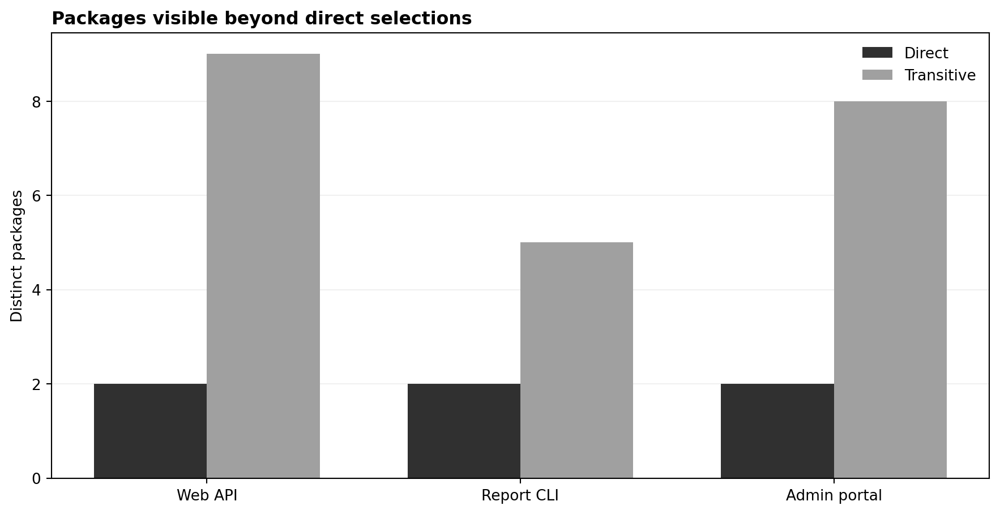
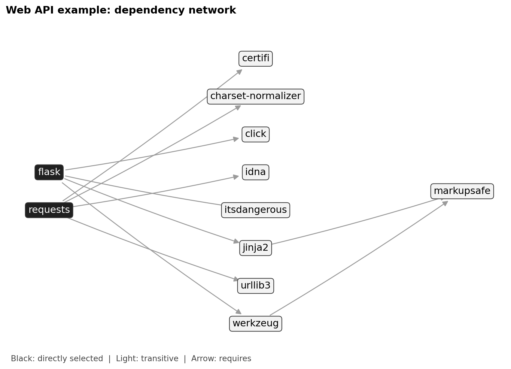
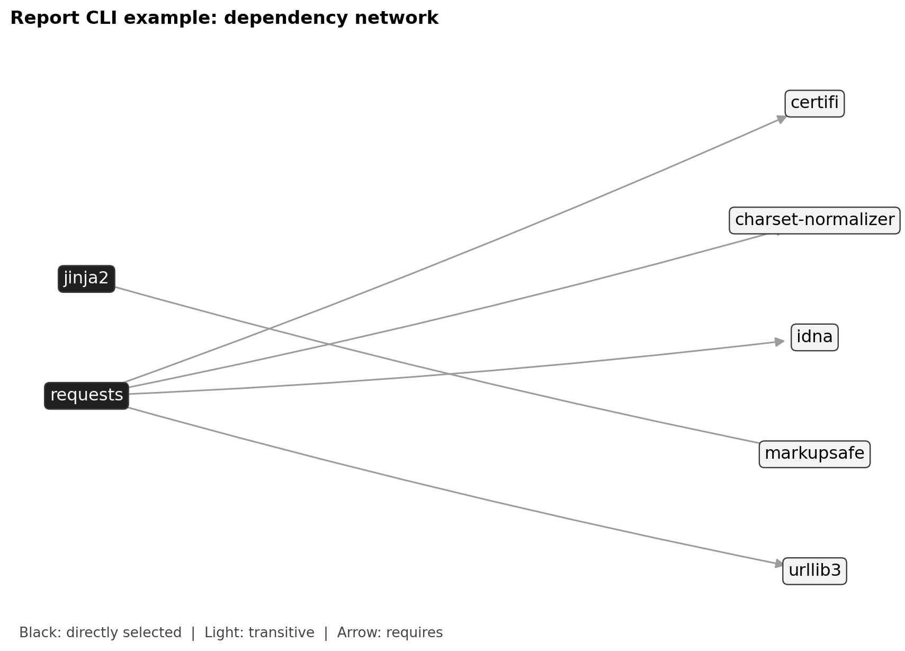
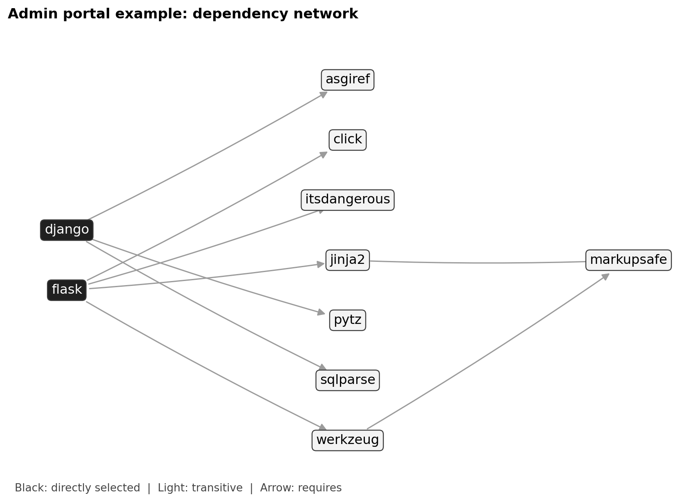

# Dependency Tree Explorer

Mapping direct and transitive dependencies in Python packages

## 1. Abstract

This exercise reconstructed three small Python dependency networks using a fixed set of real 2022-era package releases. The inputs are illustrative application profiles, not claims about particular deployed repositories. There were 3 profiles and 15 candidate packages in the shared local catalogue. Each profile was expanded from its directly selected packages and inspected for transitive requirements, dependency depth, and shared parent relationships. The study is intentionally small: its contribution is a transparent reconstruction method and an auditable output, not a large-scale estimate of ecosystem risk.

The networks were generated entirely from bundled tables. Their resulting GraphML and CSV files make it possible to check every connection shown in a figure.

## 2. Research question and motivation

When a developer selects a Python library, the installed set often contains several other packages that the developer did not choose directly. A list of top-level requirements therefore hides some of the software that will need maintenance. The question examined here is straightforward: how much dependency information becomes visible after following requirement edges, and which packages occupy different depths in the resulting graph?

The useful distinction is between a package deliberately selected by an example application and a package reached through one or more dependency steps. Neither category is inherently safe or unsafe. Directness is a structural property of a particular application, not a severity label.

## 3. Data and graph construction

The package catalogue fixes one historical version for each package. Three small profiles choose different direct roots from that catalogue. Flask brings in Werkzeug, Jinja2, Click and ItsDangerous; Jinja2 and Werkzeug both reach MarkupSafe. Requests brings in urllib3, certifi, idna and charset-normalizer. Django brings in asgiref, sqlparse and pytz. These are a deliberately selected subset of runtime requirements rather than complete resolver results; optional and environment-specific dependencies are omitted.

Each directed edge points from the package that has a requirement to the package it requires. A separate directed graph is built for each profile by taking the union of the descendants of its direct roots. Minimum depth is computed with a shortest-path search from each root. A package at depth zero is direct; all other reachable packages are transitive. Repeated paths are counted as one distinct package.

| Profile | Direct | Transitive | Max depth |
|---|---|---|---|
| Web API example | 2 | 9 | 2 |
| Report CLI example | 2 | 5 | 1 |
| Admin portal example | 2 | 8 | 2 |

*Table 1. Profile statistics computed directly from the bundled edge list.*

## 4. Observed dependency structure

The Web API example profile contains the largest distinct package set in this collection (11 packages). On average, each profile includes 7.3 transitive packages beyond its direct selections. All counts are tied to this deliberately small catalogue: they cannot be used as estimates for typical Python applications.

*Figure 1. Direct selections versus additional reachable packages for the three illustrative profiles.*

*Figure 2. Web API example. Arrows point from a requirement owner to its dependency.*

*Figure 3. Report CLI example. The same package may be a direct selection in one profile and a transitive requirement in another.*

*Figure 4. Admin portal example. Structural depth depends on which roots the profile selected.*

## 5. Checks and interpretation

I checked that every edge endpoint exists in the package catalogue, every direct root is present, the profile networks have no directed cycles, and each root receives depth zero. The program exports edge lists and per-package roles as well as the diagrams, so the drawing can be checked against the underlying graph. Running the built-in self-test repeats the main checks.

This experiment clarified why an installation list is not the same as a dependency explanation. For example, a transitive package may have two parents, and its shortest depth does not preserve every path that reaches it. An analyst looking only at the package count would miss that distinction. A dependency graph preserves the relationship, which becomes useful when known vulnerabilities are added in the later projects.

## 6. Limitations and next step

The profiles are constructed educational cases, not snapshots extracted from real production lockfiles. The dependency list omits optional requirements, environment markers, extras and differences across Python interpreter versions. It also does not establish which code paths are executed at runtime. Therefore the exported graph should not be presented as a verified software bill of materials.

The logical next step is to attach version-specific, sourced vulnerability records to the reachable packages. That is the purpose of the second project. For now, the useful result is the reproducible structure itself.

## 7. Appendix A: a worked path through the network

Consider the Web API profile. It explicitly selects Flask and Requests. Requests has four immediate requirements in the local data: urllib3, certifi, idna and charset-normalizer. Each is one step away from the Requests root, so each has minimum depth one. Flask has its own immediate requirements, including Jinja2 and Werkzeug. Both Jinja2 and Werkzeug require MarkupSafe. As a result, MarkupSafe is not one step from a root, but two steps from Flask along two different paths. The shortest-distance metric correctly records depth two while the directed graph preserves both incoming edges. This shows why depth and number of parents answer different questions.

The example also demonstrates the importance of choosing the direction of the arrows. If an edge were accidentally drawn from MarkupSafe to Flask, starting at the selected Flask root would not discover MarkupSafe as a requirement. A graph can be visually attractive and still encode the wrong relationship; that is why I exported a plain edge list next to each diagram.

The direct-versus-transitive distinction belongs to a profile, not permanently to the package. Jinja2 is directly selected in the Report CLI example, but it is reached through Flask in two other profiles. The same version therefore has different roles depending on the application's direct selections. That becomes relevant later when the portfolio compares remediation ranking rules.

| Package | Pinned version | Role in Web API | Minimum depth |
|---|---|---|---|
| certifi | 2022.9.24 | transitive | 1 |
| charset-normalizer | 2.1.1 | transitive | 1 |
| click | 8.1.3 | transitive | 1 |
| flask | 2.2.2 | direct | 0 |
| idna | 3.4 | transitive | 1 |
| itsdangerous | 2.1.2 | transitive | 1 |
| jinja2 | 3.1.2 | transitive | 1 |
| markupsafe | 2.1.1 | transitive | 2 |
| requests | 2.28.1 | direct | 0 |
| urllib3 | 1.26.12 | transitive | 1 |
| werkzeug | 2.2.2 | transitive | 1 |

*Table A1. A row-level view of the Web API network, taken from the exact exported role table.*

## 8. Appendix B: reproducibility and design decisions

The script does not run pip to install the historical packages, because installation would modify the current environment and need not reproduce the older resolution. Instead, it reads the pinned version catalogue and requirement edges as data. This isolates the graph algorithm from package installation behavior. The trade-off is clear: the table can be inspected and reproduced offline, but it does not test whether a modern resolver would choose the same versions or additional platform-specific requirements.

To check a result by hand, open profiles.csv and note the roots of the chosen profile. Follow those package names as parents in dependencies.csv, then repeat for newly reached child packages until no new names appear. Count the roots, count all other unique names, and record the fewest number of edges from any root to each reached package. These manual steps should match profile_metrics.csv and package_roles.csv. The GraphML files let a reviewer check that the figures have not hidden or invented edges.

Two mistakes would produce convincing-looking but incorrect outputs. Counting the same transitive package twice would exaggerate dependency size, especially for shared requirements such as MarkupSafe. Treating every child as one level deep would erase the distinction between a direct requirement of Flask and a second-level requirement of Jinja2. The program avoids the first by using a set of reached nodes and the second by using shortest-path lengths rather than a flat package list.

The analysis intentionally stops before answering any vulnerability question. A dependency graph describes package relationships, not whether a particular release contains a known flaw or whether an application executes the relevant code. Keeping these concepts separate made it easier to design the next two projects with fewer unsupported security claims.

## References and data provenance

[1] Python Package Index historical releases. https://pypi.org/
[2] Flask installation and dependency documentation. https://flask.palletsprojects.com/en/stable/installation/
[3] Requests source history. https://github.com/psf/requests/tree/v2.28.1
[4] Django 3.2 documentation. https://docs.djangoproject.com/en/3.2/
[5] NetworkX shortest-path documentation. https://networkx.org/documentation/stable/reference/algorithms/shortest_paths.html

## Reproduction

`python project.py` — no network calls. Input files are in `data/`; outputs are regenerated in `results/`, `figures/` and `report/`.
